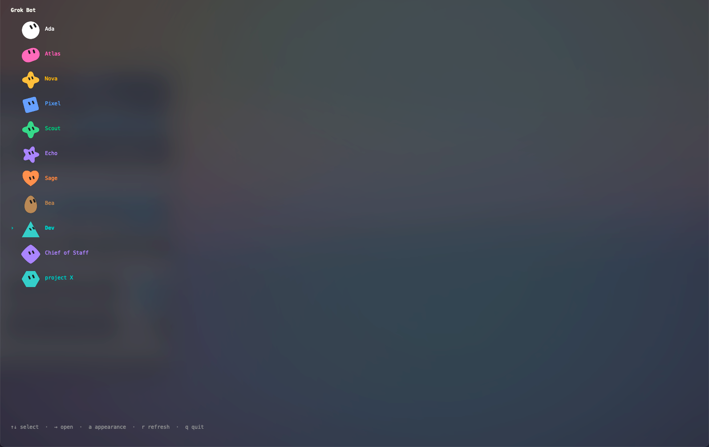
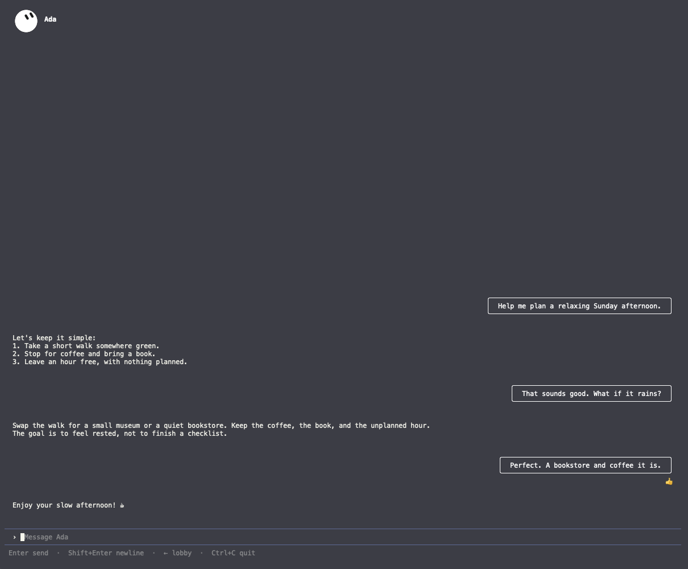
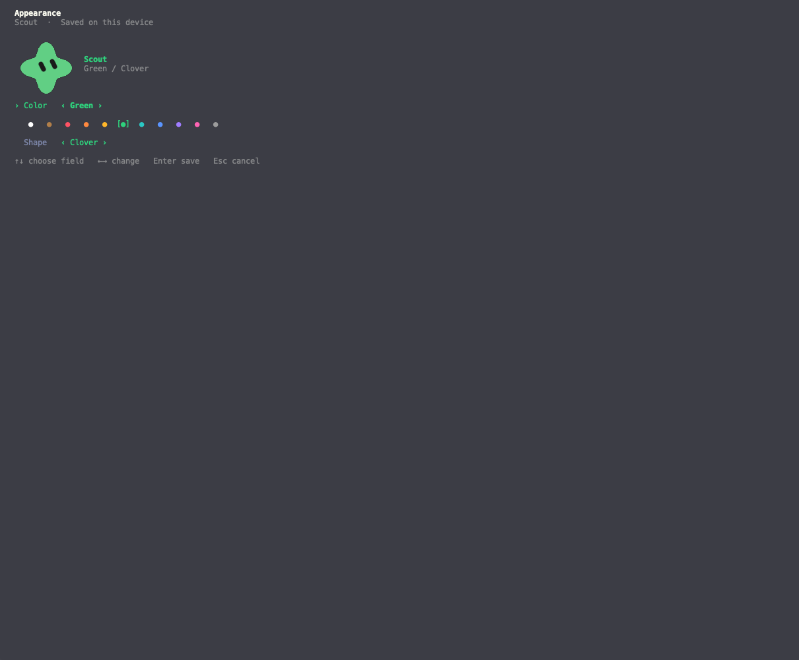

# Pebble Chat

An unofficial Grok Bot UI for your terminal, with a clean composer, right-aligned
user bubbles, image attachments, reactions and colorful animated bot avatars.

Built on [smarzban/grokbot-tui](https://github.com/smarzban/grokbot-tui) and the
transport from [ScriptedAlchemy/grok-bot-cli](https://github.com/ScriptedAlchemy/grok-bot-cli).
Both upstream projects are MIT licensed. See [attribution and modification details](THIRD_PARTY_NOTICES.md).

## Screenshots

All screenshots below use English offline fixtures. No real accounts or private conversations are shown.





## Install

Requires Node.js 22 or newer. Desktop authentication currently targets macOS with
the Grok Bot desktop app installed and signed in. The offline demo does not need an account.

```sh
git clone https://github.com/Kuanyeah/pebble-chat.git
cd pebble-chat
npm ci
npm start -- --mock
```

Run against your existing desktop session:

```sh
npm start
```

Optional global command (check whether another tool already owns `grok` first):

```sh
npm link
grok bot
grok bot --mock
grok bot --agent Ada
```

## Features

- Assistant messages on the left, your messages in transparent, rounded-outline bubbles on the right.
- Unframed emoji reactions directly below the corresponding message.
- Sent images appear as square thumbnails above the message, arranged horizontally and wrapping in narrow windows. Local image bytes are uploaded before sending.
- Real terminal cursor for IME anchoring, Unicode-aware wrapping and complete-emoji deletion.
- Persistent per-bot colors and avatars, including pure white (`#FFFFFF`).
- A short, cached avatar animation when selecting a bot.
- Bots sorted by their most recently observed assistant reply.
- English demo with eleven bots/channels and distinct avatar styles.
- Images render from their original local paths. Only path references are saved; deleting a source file removes its preview. Slower polling while idle.

## Controls

| Action | Key |
| --- | --- |
| Select / open a bot | Up/Down, Right or Enter |
| Edit selected bot's appearance | `a` in the lobby |
| Return to lobby | Left with empty input |
| Send / newline | Enter / Shift+Enter or Ctrl+J |
| Recall previous input | Up/Down at the first/last input row |
| Move by word / delete previous word | Option+Left/Right / Option+Delete |
| Clear input | Command+Delete or Ctrl+U |
| Stash / restore draft | Ctrl+S |
| Remove last staged image | Ctrl+X |
| Scroll transcript | Mouse wheel or Page Up/Down |
| Exit | Ctrl+C on an empty prompt |

Paste or drag an image file into a terminal that inserts its local path (tested
with Rex). The TUI stages square previews above the composer without adding markers to your text; Enter uploads them. Clipboard integration
and Option/Command key encoding depend on your terminal.

## Configuration and limits

Appearance and recently observed reply times are stored in
`~/.config/grokbot-tui/`. Set `GROK_TUI_PROFILE_DIR` to isolate those files.
Set `GROK_TUI_REDUCED_MOTION=1` to disable selection animations.

Desktop credentials are read from the existing encrypted app session and kept
out of the repository. Never publish your `.env`, desktop data or profile directory.

Image upload currently supports the backend's `SINGLE_PUT` mode, up to 20 MB per
file. Unsupported upload modes fail explicitly. Prompt submissions are not
replayed automatically after uncertain delivery errors. Backend APIs are unofficial
and may change; mock tests are not a guarantee of live compatibility.

Avatar artwork is independently drawn and inspired by the desktop shapes; it is not an official asset export or a pixel-identical 3D renderer.

Kitty-capable terminals render full-color avatars; other terminals use the image
library's fallback. The UI uses an alternate screen. This repository does not
modify Rex, Codex or Claude Code.

## Development

```sh
npm ci
npm test
npm run demo
```

Source is plain ES modules in `src/`, tests in `tests/`, and the executable in
`bin/`. `npm ci` applies the narrowly scoped Kitty positioning patch. A Zod
override fixes the vulnerable transitive version used by the image dependency.

## License

MIT. Original upstream copyright notices are preserved in `licenses/`.
